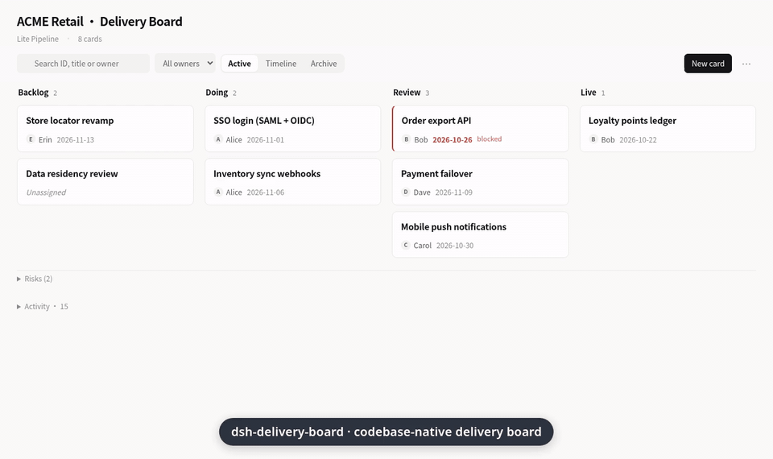
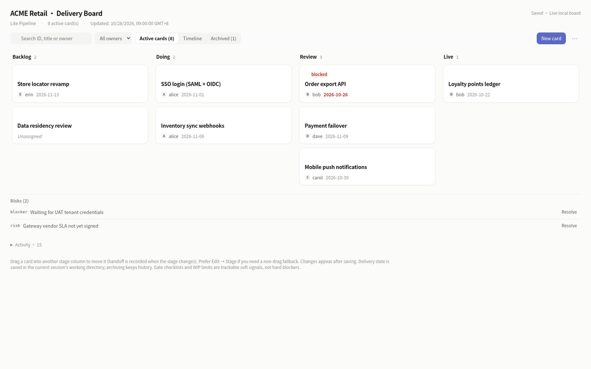
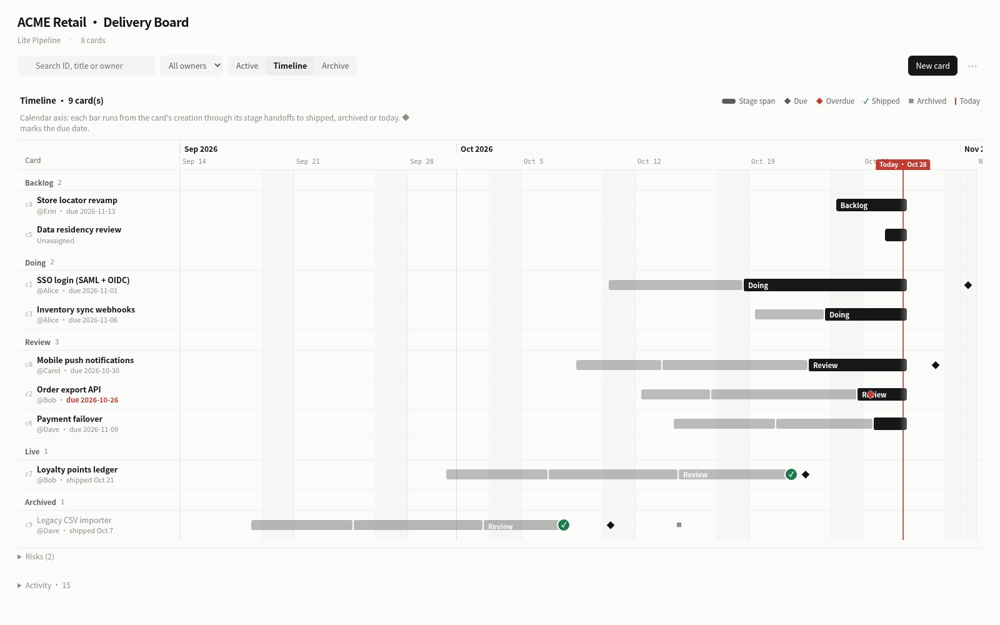
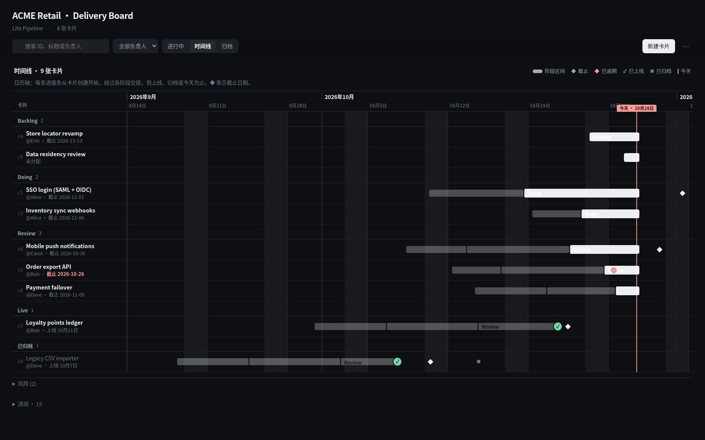
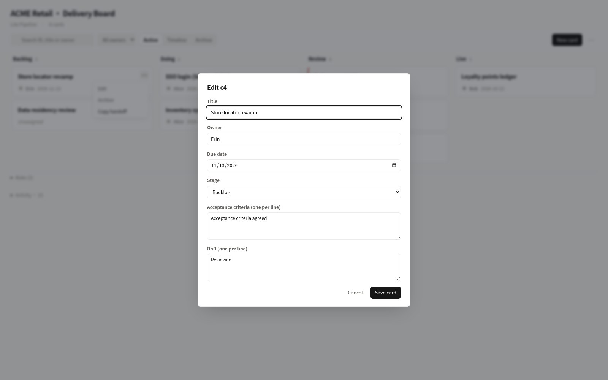
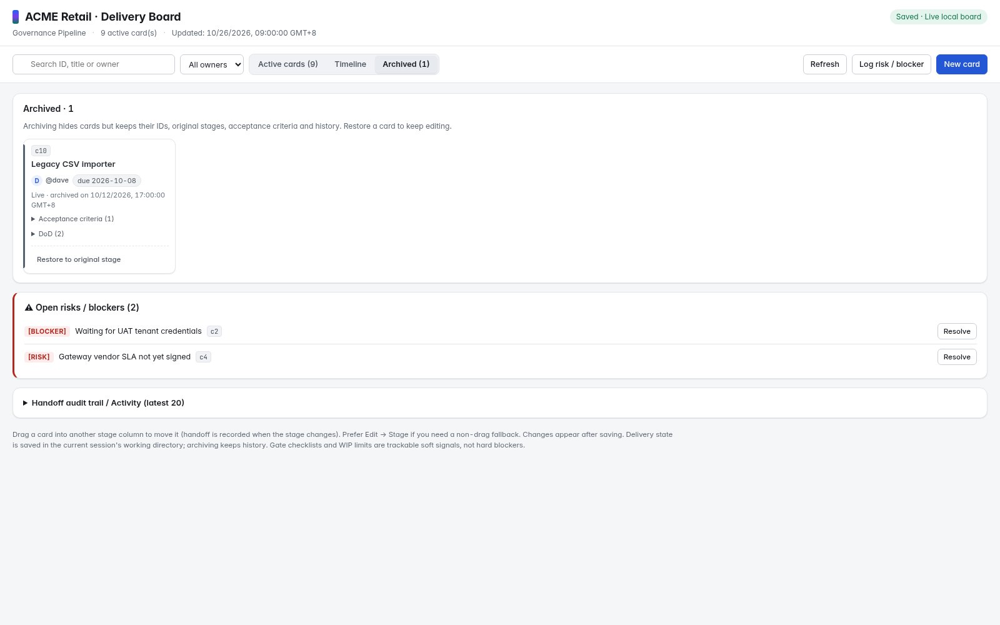

# dsh-delivery-board

[English](README.md) · [中文](README.zh.md)

> **给人与 Agent 共用的仓内交付看板** — 阶段流水线、交接留痕、软 WIP、客户周报，以及本地 Timeline 界面；全部落在仓库里的一份交付状态上。



*约 25 秒无声演示（v0.2.2 界面 · 英文叠字 · 虚构数据）。需要下载可看 [MP4](docs/demo/demo.mp4)。*

## 30 秒快速开始

**独立 CLI（无需 DeepSeek Harness）：**

```bash
npx dsh-delivery-board init ACME lite
npx dsh-delivery-board card '{"title":"API integration","stage":"doing","owner":"Ada"}'
npx dsh-delivery-board open    # 本机看板 + Timeline；Ctrl+C 结束
npx dsh-delivery-board weekly
```

**作为 [DeepSeek Harness](https://github.com/deepseek-ai/deepseek-harness)（`dsh`）插件**（`/delivery` skill 工作流）：

```bash
dsh plugin --profile web add github:jerryxff26-alt/dsh-delivery-board
```

桌面版：在插件管理中安装同一个 GitHub 来源。（上面的 CLI 安装路径已验证；桌面插件管理流程未单独验证。）已在 DSH **0.2.1-rc.2** 测试（亦兼容 **0.2.0-rc.2**），无运行时依赖。

## 为什么存在

从 Plan 到需求、设计、开发、测试再到上线，交付状态如果和代码不在一起，人和 Agent 就很难对齐：谁负责、怎样算完成、哪里卡住，往往散落在交接和口头同步里。

**dsh-delivery-board** 把阶段流水线、交接留痕和客户周报写入仓库内的交付状态（默认 `delivery.json`）。看板、日历 Timeline、审计与周报只是同一份状态的不同视图，不是另一套 SaaS。PM、研发、测试和 AI agent 共用同一个、能跟着仓库走的 Source of Truth。

## 和其他方案比

| 需求 | 本项目 | 常见 SaaS 看板 | 仅 Markdown 清单 |
| --- | --- | --- | --- |
| 落在 git 仓库里 | 是（`delivery.json`） | 多为远程工作区 | 是，但缺少结构化交接 / WIP |
| 交接审计 + 客户周报 | 内置 | 需自定义字段 / 导出 | 手工 |
| 本地可编辑 UI + Timeline | 本机环回看板 | 完整 Web 应用 | 无 |
| 配合 AI coding agent | DSH skill + 工具；任意 shell 可用 CLI | 多经 API / MCP | 仅靠提示词 |
| 范围 | 单仓库交付上下文 | 组织级 PM 套件 | 轻量笔记 |

刻意**不是**重造 Jira、Linear 或 Notion——那些适合组织级规划。这里只保留当前仓库真正需要的交付上下文，可离线、可在 PR 里审阅。

如果它帮你少开一次对齐会、少贴一次凌乱周报，点一颗 [⭐ star](https://github.com/jerryxff26-alt/dsh-delivery-board) 能让更多人发现它——谢谢。

## 设计原则

- **Delivery state 是一等公民**：阶段、负责人、验收标准（AC）、完成定义（DoD）、交接与阻塞，都留在仓库里，跟随 Git 演进。
- **视图解耦**：本地看板、交接审计、客户周报、离线 HTML，都是同一份交付状态的 Projection。
- **用 CLI 或 DSH 操作**：用 `npx dsh-delivery-board …`、`/delivery` 或自然语言推进阶段、补 AC、记阻塞、出周报；不必把 JSON 当成日常手工编辑界面。
- **边界清晰**：不重造企业级项目管理平台，只把当前仓库交付真正需要的上下文留在 codebase 里。

## 你能得到什么

- **阶段流水线 + 卡片**：每张卡有负责人、截止日期、验收标准和完成定义（DoD）。初始化后仍可增删改阶段（删除时若该阶段仍有卡片，需先 `migrate_to` 迁走）。
- **交接审计**：卡片跨阶段移动时自动记录交接（谁、从哪到哪、备注）。
- **周报**：生成 Markdown 客户周报：流水线快照、**本周已交付**（进入末级阶段或归档）、交接、未关闭风险，以及**本周已消化风险**。可选 `next_week` 笔记会输出为 **Next bets（下周投注）**；为空则省略。
- **软 WIP 上限**：阶段可选 `wipLimit`（看板风格）。看板与移动反馈会提示超限，但**从不拦截**移动。
- **本地可编辑看板**：`/delivery Open the editable board` 在 `127.0.0.1` 上提供鼠标拖拽看板，保存回同一份交付状态；归档/恢复、风险/阻塞记录，以及可勾选的关卡清单均可在看板操作。无障碍回退：编辑卡片里的 Stage。看板界面文案会跟随浏览器语言（中文环境优先 zh-CN）。
- **时间线视图**：按真实日历日期展示每张卡片的甘特条（创建 → 各阶段交接 → 上线 / 归档 / 今天），带“今天”标线、周/月网格线、◆ 截止标记（逾期为红色），没有日期的卡片单独列出。与看板共用搜索和负责人筛选，点击标题即可编辑；浅色/深色主题跟随系统。
- **离线 HTML 快照**：单个只读文件，没装 DSH 的同事也能打开。





<details>
<summary>卡片编辑、归档与深色模式</summary>







</details>

## 独立 CLI

与插件共用同一套领域能力（阶段、交接、软 WIP、周报、本地看板 + Timeline）。默认在当前目录读写 `delivery.json`（可用 `--cwd` / `--file` 覆盖）。

```bash
npx dsh-delivery-board help
npx dsh-delivery-board init Demo lite
npx dsh-delivery-board board
npx dsh-delivery-board open
npx dsh-delivery-board weekly 2026-10-20
npx dsh-delivery-board html
```

命令形态与 DSH 插件里的 `/delivery-admin` 一致。`open` 会保持进程直到 Ctrl+C。

## DSH 插件快速开始

```bash
dsh plugin --profile web add github:jerryxff26-alt/dsh-delivery-board
```

### 日常只做这些（主路径）

1. **初始化** — `lite` 模板（或 `/delivery Initialize a lite board for ACME`）
2. **建卡** — 可观察结果 + 阶段
3. **交接** — `move` / 拖拽看板
4. **周报 / 开看板** — `weekly` / `open`

`/delivery` = 模型 skill（日常主入口）。`/delivery-admin` = 不经模型的确定性逃生舱。日常优先 `/delivery`。

**安静高端 UI（v0.2.5）：** Linear / Things 级克制——单一靛蓝强调色、列头仅阶段名+计数、卡片正面只留标题/负责人/到期、操作悬停才出 ⋯、关卡收进看板下方折叠区、工具栏只留搜索/视图/新建（刷新与记风险进 ⋯）。深色模式同规则。仍无 CDN 字体、无新依赖。

**更克制的看板 UI（v0.2.4）：** 更柔和的配色、细而克制的阶段色条、卡片更疏、AC/DoD 默认收成芯片、Edit/Archive/Copy 藏进 ⋯ 菜单。

**少一点摩擦（v0.2.3）：** 阶段/卡片可用 **id 或名称/标题**（不区分大小写，须唯一；报错列候选项）。支持位置参数：`init ACME lite`、`card API doing Ada`、`move API review`。看板闸门与审计默认折叠；未关闭风险保持可见。

然后在会话里：

```text
/delivery Initialize a lite delivery board for ACME
/delivery Open the editable board
```

高级、确定性命令：`/delivery-admin help`。

## Skill 与工具

`/delivery` skill 会先读仓库上下文、找缺口，再提出阶段与卡片方案；得到确认后才通过 `delivery_*` 工具写入。**模型负责推理；工具负责落盘。**

| 模板 | 阶段 | 关卡 |
|---|---|---|
| **`lite`（轻量流水线）** — 推荐快速开始 | Backlog → Doing → Review → Live | 无 |
| `default`（ToB 交付流水线） | Client Requirements → BA Analysis → TL Design → Development → Testing → DevSecOps Launch → Live | 每阶段 1–2 个（如验收标准冻结、安全扫描通过） |
| `governance`（治理型交付流水线） | Plan → Analyze → Design → Build → Test → Deploy → Live | 侧重质量/风险/安全签核（如回滚方案就绪） |

可通过 `stages` 参数完全自定义阶段。关卡是**可勾选跟踪的清单**，持久化在交付状态中，**不会强制拦截**卡片移动。除非明确需要更长的 ToB / 治理流水线，优先用 `lite`。

## 工具

**日常环**（优先用这些）：

| 工具 | 作用 |
|---|---|
| `delivery_init` | 初始化（优先 `lite`；或 `default` / `governance` / 自定义阶段） |
| `delivery_card` | 新增卡片 |
| `delivery_move` | 跨阶段移动并记录交接；同阶段只改负责人时记为决策 |
| `delivery_board` | 文本看板 |
| `delivery_open` | 本地可编辑看板 URL |
| `delivery_update` | 修改卡片信息（不移动） |
| `delivery_log` | 记录进展 / 风险 / 阻塞 / 决策 |
| `delivery_weekly` | 客户周报（Markdown）：已交付 / 交接 / 风险 / Next bets |

**高级**（仍注册；仅在明确需要时用）：

| 工具 | 作用 |
|---|---|
| `delivery_archive` / `delivery_restore` | 归档 / 恢复到原阶段 |
| `delivery_board_html` | 只读离线 HTML 快照 |
| `delivery_resolve` | 按 logs 下标将未关闭的风险/阻塞标记为已解决 |
| `delivery_gate` | 勾选/切换阶段关卡清单项（可跟踪，非硬拦截） |
| `delivery_stage_add` / `delivery_stage_update` / `delivery_stage_remove` | 初始化后演进流水线（有卡片时删除需 `migrate_to`；阶段可设软 `wip_limit`） |

## 团队协作与安全

- 交付状态默认落盘为仓库内文件（默认名 `delivery.json`，可配置），提交到团队共享 git 仓库后 `git pull/push` 即可同步；并发修改仍需正常解决冲突。
- 本地看板只绑定 `127.0.0.1`、随机端口和不可猜测的路径；URL 仅限本机使用，DSH 退出或插件卸载后失效。
- 页面数据过期时不会静默覆盖，需要点 **Refresh** 后重试。

## 开发

```bash
npm install
npm run check
npm test               # 领域、HTML、命令、存储、HTTP、插件与 skill 测试
npm run test:desktop   # 可选：再加桌面 SDK 上的 skill 注册/加载测试
```

本地桌面开发（macOS，已在 DSH 0.2.1-rc.2 验证）：

```bash
DSH_CLI="/Applications/DeepSeek Harness.app/Contents/Resources/runtime/cli/bin/dsh"
"$DSH_CLI" plugin --profile desktop add "link:$PWD" --offline --ignore-scripts
```

安装或改动 link 插件后请完全退出并重开 DSH，确认 **Plugins → dsh-delivery-board** 为 **Running**。`--dump-config` 适用于 CLI 管理的 profile（如 `web`），不适用于 desktop profile。若应用路径不同，可设 `DSH_DESKTOP_APP`。

### 实现说明

- 插件契约 `name / inject / Config / apply`；工具经 `defineTool`；捆绑的 `skills/delivery/SKILL.md` 经 `ctx.skills.register` 注册。工具输出渲染为 `ContentBlock[]`。
- 领域逻辑（`lib/delivery.js`）与 HTML 渲染（`lib/board-html.js`）为纯函数；写入都走 `lib/store.js`。DSH 插件使用 `ctx.fs`；独立 CLI 通过 `lib/node-fs.js` + `lib/standalone.js` 使用同一套 store 契约。
- 周报覆盖从 `week_start` 起连续七个本地日历日（默认本周一）。**本周已交付** = 该窗口内进入末级阶段的交接，或归档；未关闭风险单独列出；**本周已消化风险**按窗口内的 `resolvedAt`。`next_week` 有内容时输出 **Next bets** 节。
- 阶段关卡为可跟踪清单（`gateDone`），**不**拦截移动。
- 软 **WIP 上限**（`wipLimit` / 工具字段 `wip_limit`）为阶段可选项；超限只在看板与移动反馈中警告，从不拒绝移动。
- 初始化后可用工具或 `/delivery-admin` 增删改阶段；删除仍有卡片的阶段必须提供 `migrate_to`。
- HTML 中用户内容均转义（有测试覆盖）。

## 实践说明（轻量）

从适合「仓库内看板」的交付实践里挑了能落地、又不做成重型 PM 套件的两点：

- **看板软 WIP**：给忙碌阶段设 `wip_limit`，超载一眼可见。
- **周报 shipped / next bets**：带一点 Shape Up 味道——本周落地了什么、消化了什么风险、下周押什么（仍然只是 Markdown + 仓库内状态）。

## 不做清单（Won't build）

硬产品边界——本项目保持「本地 / 仓内交付看板」：

- 硬拦截关卡或硬 WIP（不做流程引擎）
- 多项目 / 多 workspace 汇总或组织级 portfolio
- 云端通知、邮件/IM 推送、账号与 SSO
- 自定义字段泛滥 / 多种 issue type 体系
- Dual Track 发现↔交付、DoR、appetite 等「方法论模块」对外产品化
- 实时多人 CRDT 协同、甘特资源负载、燃尽图套件
- 把每个 admin 子命令都升成一级 Agent 工具

## 可能以后做（非对外承诺）

- 把可编辑看板嵌进 DSH（独立 CLI 已发布）
- 周报与工具消息的更完整 i18n（看板界面已跟随浏览器语言）

## 已知限制

- **独立 CLI** 只需 Node ≥20（`npx dsh-delivery-board`）。DSH 插件路径为开发者预览：`engines.dsh >=0.2.0-rc.2 <0.3.0`；peers `@deepseek-ai/dsh-tools >=0.2.0-rc.2 <0.3.0`、`@deepseek-ai/schemastery ~3.18.5`（由宿主提供，optional）。已在 DSH 0.2.1-rc.2 冒烟验证；此前在 0.2.0-rc.2 验证过。
- 无甘特排期、自动批量归档、硬拦截关卡/WIP，或实时多用户同步。
- 拖拽（以及编辑 → 阶段回退）在本地浏览器 harness 中检查过；不做完整键盘/移动端/WCAG 声明。
- 关卡清单与 WIP 上限只是软信号；移动卡片不要求关卡全部勾选，也不要求 WIP 未超限。
- 空列与未初始化项目只指向**一个**下一步（`init` / `delivery_init` / `/delivery …`，或看板上的「新建卡片」）。

## 许可证

[MIT](LICENSE) © 2026 jerryxff26-alt
